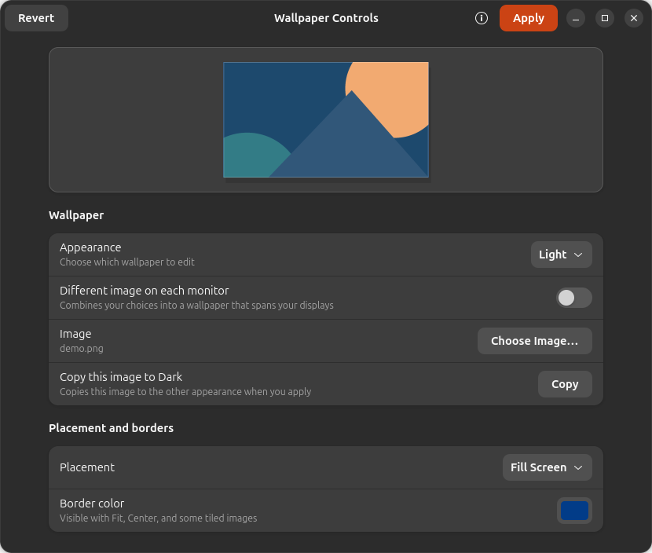

# Wallpaper Controls

Wallpaper Controls is a small GTK4/libadwaita app for Ubuntu and other GNOME
desktops. It restores the wallpaper placement choices missing from recent
settings panels and shows a preview before anything changes.



## Features

- Fill, Fit, Stretch, Center, Tile, and Span Displays
- Separate wallpaper images for Light and Dark appearance
- A border color for fitted, centered, and tiled images
- A different image on each connected monitor, composed into a single spanned wallpaper
- **Apply** and **Revert** controls so edits do not immediately change your desktop
- **Open With → Set as Wallpaper** for images in Files

## Install on Ubuntu

Install the system packages:

```sh
sudo apt install python3-gi python3-pil gir1.2-gtk-4.0 gir1.2-adw-1 gir1.2-gdkpixbuf-2.0
```

From this folder, run:

```sh
./install.sh
```

Find **Wallpaper Controls** in the app launcher. The installer works in your
user account and does not require `sudo`. You can also run `./run.sh` without
installing. To remove the app, run `./uninstall.sh`; it keeps your wallpaper
images and preferences so your current desktop image does not disappear.

## How to use it

Choose **Light** or **Dark**, select an image, and adjust its placement. The
preview updates while GNOME's wallpaper stays unchanged. Press **Apply** when
you are happy with the result, or **Revert** to discard the edits. **Copy this
image to Dark/Light** copies the selected image to the other appearance when
you apply.

For separate images on each monitor, turn on **Different image on each
monitor** and choose an image in each connected monitor row. Repeat for the
other appearance if you want different Light and Dark sets. The same placement
choice applies inside every monitor. Press **Apply** to generate and use the
combined wallpaper.

The file-manager action opens Wallpaper Controls with the selected image staged
for both appearances. You still need to press **Apply**.

## Where files go

The app stores per-monitor choices in
`~/.config/wallpaper-controls/monitors.json` and generated wallpapers in
`~/.local/share/wallpaper-controls/generated/`, using the corresponding XDG
locations when those variables are set. It does not upload images or use the
network.

## Current limits

- GNOME exposes one wallpaper URI for Light and one for Dark. Per-monitor mode
  combines the chosen images into one PNG and uses GNOME's Span Displays mode.
- Mirrored displays cannot show different wallpapers.
- After changing the monitor arrangement, reopen the app and press **Apply**
  to regenerate the composite for the new layout.
- The single-image preview models a 1920×1080 screen. Center and Tile may look
  different on a screen with another resolution.
- Per-monitor composition uses Pillow's supported raster image formats. PNG,
  JPEG, WebP, GIF, BMP, and TIFF are supported on typical Ubuntu installations.

## Development and release

Run `/usr/bin/python3 -m pytest -q` to check image composition. See
[RELEASING.md](RELEASING.md) for the public release process and current Flathub
constraints. The project is licensed under
[GPL-3.0-or-later](LICENSE).
